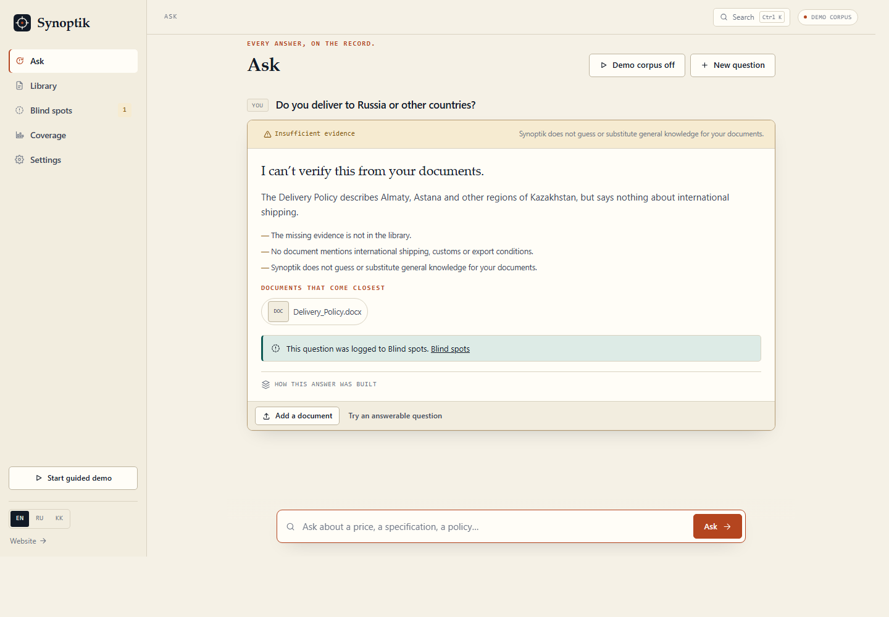
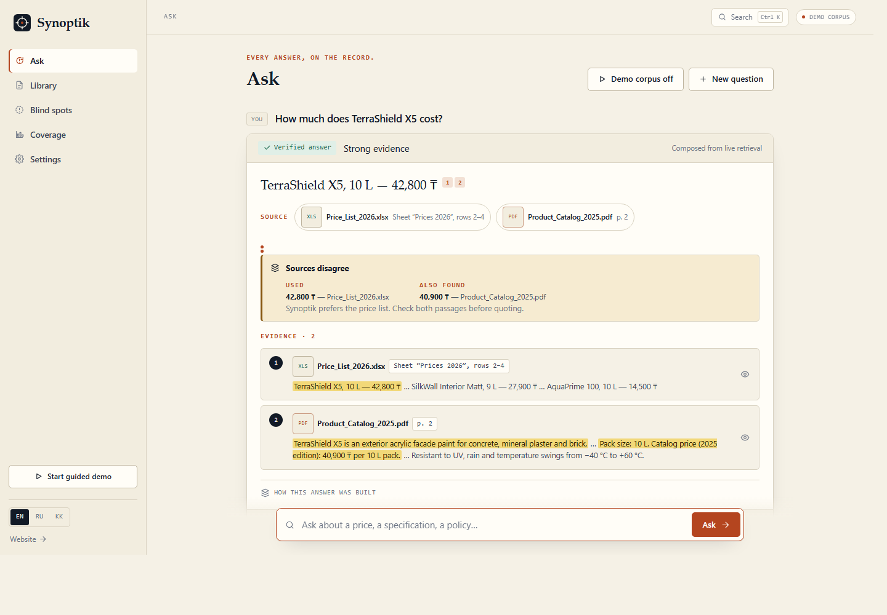

# Synoptik

**Every answer, on the record.**

[](https://github.com/yermukhamed0777/synoptik/actions/workflows/ci.yml)

Synoptik is an evidence-first retrieval workspace for business documents. Ask a question in plain language; get a short answer, the exact passage it came from, and the file and location — or an explicit refusal when the documents do not support an answer.

English · Русский · Қазақша. Runs entirely in the browser. No account, no API key, no upload endpoint.


| A cited answer | A refusal |
| --- | --- |
|  |  |

The refusal does not disappear — it becomes a ledger of what the documents do not cover:


When two documents disagree, the answer shows both values and says which one it used:



---

## Why this exists

General-purpose assistants are optimized to sound helpful. In a price list, a delivery policy or a technical specification, sounding helpful is the failure mode: a fluent sentence that cannot be checked against a line in a file is a liability.

Synoptik inverts the contract:

| A typical assistant | Synoptik |
|---|---|
| Generates a plausible answer | Extracts a verbatim passage |
| Cites rarely, often a link | Cites file, page, sheet/rows, exact text |
| Improvises when evidence is missing | Refuses and logs the question |
| Sends documents to a vendor | Keeps them in the browser tab |
| Requires an account and an API key | One static build, zero credentials |

The refusal is the product. Every refusal becomes a **blind spot** — grouped by topic, counted, and turned into a content backlog for the team that owns the documents.

## Status: what is real

This is a working v0.1, not a mockup. It is also deliberately honest about its edges.

| Part | Status |
|---|---|
| TXT, Markdown, CSV, DOCX, XLSX parsing | **Real**, client-side, with page / sheet + rows / paragraph / line locators |
| PDF parsing with layout and table reconstruction | **Real** (pdf.js bundled locally), with a stream-parser fallback |
| Scanned PDFs and images | Optional local OCR via Tesseract.js (loaded from a CDN on demand) |
| Retrieval | **Real**: BM25 with RU/KK stemming, cross-script transliteration, unit normalisation, typo tolerance and document-intent routing. Lexical, not embeddings. |
| Evidence validation and abstention | **Real**: IDF-weighted coverage; identifier traps (20 L vs 10 L), conflicting prices and comparison questions are handled explicitly |
| Answers | **Extractive**: the sentence shown is copied from a retrieved line, never generated |
| Conflicting documents | **Real** for prices: when a price list and a catalog disagree, the price list wins and both values are shown |
| Comparison questions | **Refused** in live retrieval until comparison composition exists; one curated demo comparison still answers |
| Demo corpus (7 documents, 28 passages, 27 questions) | Pre-written, fictional company, curated demo answers labelled *pre-verified* |
| Optional local semantic search | multilingual-e5-small via Transformers.js, on-device, off by default |
| Accounts, roles, audit log, server-side index | **Not implemented** |
| Telemetry / analytics | None. Counts live in this browser only. |

### Measured on the demo corpus

`npm run eval` grades retrieval only, against the line the user would actually see. The suite is a regression instrument, not a generalisation benchmark: the questions were written against this corpus, and the paraphrase set was used while tuning this milestone.

| Set | Answerable correct | Wrong | Refusals | p95 |
|---|---|---|---|---|
| Curated (81 questions, 3 languages) | 95.5% | 0 | 100% | 5.25 ms |
| Paraphrase / traps (29 questions) | 95.2% | 1 | 100% | 6.07 ms |
| **Combined** | **95.4%** | **1.2% of answers** | **100%** | — |

Full scorecard and failure list: [eval/scorecard.md](eval/scorecard.md). The remaining failures are three live comparison questions (refused by design) and one primer question that quotes the wrong compatibility line. Real-corpus scorecards from design partners are the number that matters next.

## Run it

Requires Node.js 20+.

```bash
node build.mjs        # writes dist/ — landing page + workspace + vendor files
node scripts/serve.mjs
# http://127.0.0.1:4173/          marketing site
# http://127.0.0.1:4173/app.html  workspace
```

There is no dependency install step. The build copies native ES modules and two HTML shells; `dist/` is a plain static site that can be hosted on any static host. No environment variables are required.

### Tests

```bash
npm test                 # node --test tests/
```

`npm test` runs all six test files with Node's built-in test runner — no worker spawning and no dependencies. To run a subset, invoke the files directly, e.g. `node tests/engine.test.mjs`.

The suite covers tokenisation and BM25 behaviour, the identifier guard, refusals, price conflicts, corpus integrity (every curated citation points at a real line), translation parity, parser fixtures (DOCX/XLSX/CSV/TXT), a demo-corpus retrieval floor, and a scan for credential-shaped strings.

### Evaluate

```bash
npm run eval                 # writes eval/scorecard.md
npm run eval:verbose         # prints every failure
node scripts/evaluate.mjs --corpus ./eval/corpora/acme --set ./eval/sets/acme.json
```

See [eval/README.md](eval/README.md) for the set format and how to score a real corpus.

### Visual QA

Headless Chrome is driven over the DevTools protocol. With the preview server running and Chrome started with `--remote-debugging-port=9222`:

```bash
node scripts/cdp-verify.mjs   # landing, workspace pages, evidence drawer
node scripts/cdp-flows.mjs    # refusal → blind spot → add document → resolved answer
node scripts/cdp-evidence.mjs # live price conflict and comparison refusal
node scripts/cdp-pdf.mjs      # generate a PDF, upload it, verify extraction
node scripts/cdp-ui.mjs       # onboarding, guided demo, dark theme, mobile
```

Screenshots are written to `artifacts/` (ignored by git).

## Architecture

```
src/
  brand.js                  product identity constants
  theme-init.js             pre-paint theme (keeps CSP strict, no inline script)
  domain/
    engine.js               morphology, transliteration, BM25, intent routing, evidence, conflicts, abstention
    corpus.js               fictional demo corpus (documents, passages, curated Q&A)
  app/
    state.js                localStorage state, document list, upload pipeline
    ask.js                  curated + live answer pipeline, custom backend client
    parsers.js              ZIP, XLSX, DOCX, CSV, TXT, PDF layout + stream fallback
  ai/
    local.js                optional Transformers.js embeddings and Tesseract OCR
  ui/
    main.js                 router, events, ask flow, quick search, guided demo
    landing.js              marketing page (separate, lightweight entry)
    pages/                  ask, library, blind spots, coverage, settings
    overlays.js             evidence drawer, document drawer, quick search, onboarding
    format.js, icons.js     formatting and the inline icon set
  styles/                   base tokens, landing, workspace
eval/                       question sets, scorecard format, ignored real corpora
tests/                      engine, corpus, parser, i18n, retrieval-floor tests
build.mjs                   static build (no bundler, no dependencies)
scripts/                    preview server, evidence evaluator, CDP QA harnesses
vendor/                     pdf.js (Apache-2.0)
```

### The answer pipeline

1. **Parse** the file in the browser. Every passage keeps a locator taken from the file itself.
2. **Index** passages with BM25. Russian and Kazakh are stemmed, Cyrillic is transliterated for cross-script brand names, units collapse (`10 л` = `10 L`), and a concept map bridges prices/costs/стоимость/баға.
3. **Route** the question by intent (price, delivery, warranty, compatibility, specification) so the document that owns the answer ranks first.
4. **Score lines** inside each candidate passage, preferring money-bearing lines for price questions.
5. **Verify** IDF-weighted coverage of the question. Below the configured threshold, return an abstention with the missing terms.
6. **Compose** the answer from the winning line. Citations are indices into the evidence array, so an answer without evidence cannot be rendered.

Guards that matter in practice:

- **Identifier guard** — a quantity or code in the question must appear in the chosen passage. Asking for a 20 L pack cannot silently return the 10 L price.
- **Price conflict** — if a price list and a catalog quote different amounts for the same product, the price list is used and both values are shown with their sources.
- **Comparison refusal** — a single extracted line cannot honestly answer "what is the difference between A and B", so live retrieval refuses instead of quoting one side.
- **Price/date/address boosts** — money, dates and addresses count more when the question is about them, without allowing them to override coverage.

### Custom backend (optional)

Settings accepts a URL, never a key. The page POSTs:

```json
{ "question": "…", "language": "en|ru|kk", "threshold": 0.6 }
```

and expects:

```json
{
  "status": "answer|abstain",
  "answer": "…",
  "details": ["…"],
  "strength": "strong|moderate|limited",
  "citations": [{ "doc": "file.pdf", "location": "p. 4", "excerpt": "…" }],
  "ms": 120,
  "scanned": 4210,
  "coverage": 0.82
}
```

An answer without citations is rendered as a refusal.

## Privacy and security

- Documents are parsed and indexed in the tab. There is no upload endpoint.
- State is stored in `localStorage` under `synoptik.state.v1`. Settings → Reset clears it.
- No API keys are required, shipped or stored. The optional backend field accepts a URL only.
- Both HTML shells set a Content-Security-Policy: scripts execute only from `self` (plus jsDelivr for the optional local model and a blob worker), and `connect-src` permits `self` and operator-chosen HTTPS endpoints. Model weights are normally fetched from Hugging Face when the local model is enabled. The CSP is not "only jsDelivr" — see [SECURITY.md](SECURITY.md) for the exact posture.
- The demo corpus is fictional: Zhaiyk Coatings, `support@zhaiyk-coatings.example`, synthetic prices and policies. No real customer data is included.
- `tests/brand.test.mjs` fails `npm test` if credential-shaped strings or unexpected emails enter `src/`; CI runs it on every push.

See [SECURITY.md](SECURITY.md) for the disclosure policy and known limits.

## Known limitations

- Lexical retrieval misses pure synonyms. The optional local embedding model is the answer; it is not enabled by default.
- Comparison questions ("difference between A and B") are refused in live retrieval. One curated demo answer covers a comparison, but composition is an M1/M2 item.
- Price-conflict detection is a conservative heuristic: it needs a shared query term, a tenge amount and a price/catalog document name. It does not verify that the *same product* appears on both sides, handle other currencies, or reconcile units, tiers and dated price lists yet.
- The 95.4% scorecard is a regression suite written against the demo corpus, not evidence of real-world accuracy. Design-partner corpora are the next measurement.
- The lightweight PDF stream parser handles simple text streams only. Use the bundled pdf.js path for normal PDFs; scans need OCR.
- XLSX parsing covers sheets, merged cells, dates and header detection, not formulas or charts.
- `localStorage` is roughly 5 MB. Large corpora belong on the server-side roadmap.
- The marketing page is client-rendered. Static generation is a planned milestone.
- No authentication, access control or audit log yet. Do not put confidential documents into a shared browser profile.

## Roadmap

The market thesis and milestones live in [plan/strategy.md](plan/strategy.md). The executable backlog, decision log and progress log live in [plan/README.md](plan/README.md). The short version: harden real-corpus accuracy, add a server-side index with accounts and an audit trail, then sell the evidence workflow to multilingual industrial distributors and compliance teams — not another general chatbot.

---

Source is published for evaluation and review; commercial use requires permission — see [LICENSE](LICENSE). Demo data is fictional. Third-party components retain their own licences (`vendor/pdf.js` — Apache-2.0).
