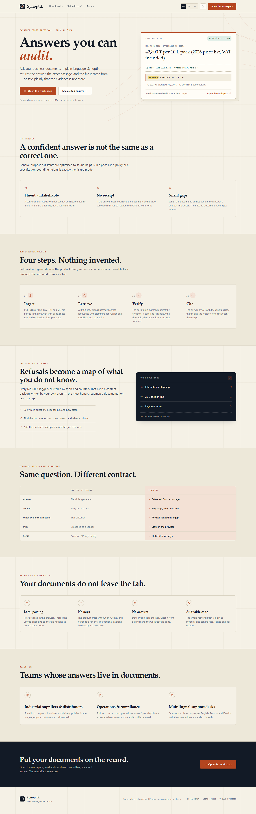
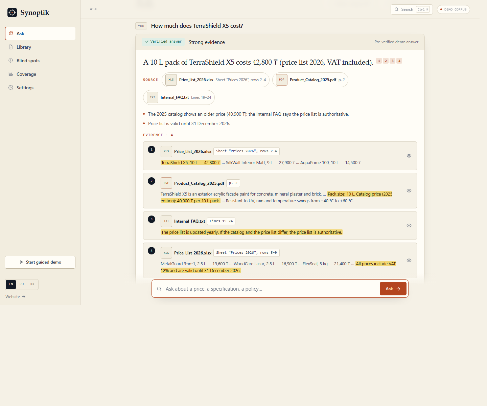
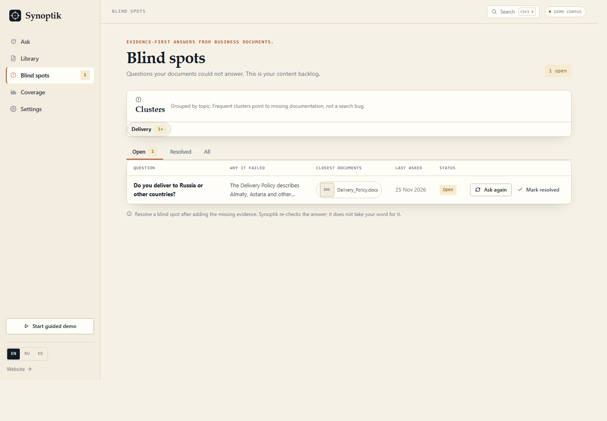

# Synoptik

**Every answer, on the record.**

Synoptik is an evidence-first retrieval workspace for business documents. Ask a question in plain language; get a short answer, the exact passage it came from, and the file and location — or an explicit refusal when the documents do not support an answer.

English · Русский · Қазақша. Runs entirely in the browser. No account, no API key, no upload endpoint.



| A cited answer | A refusal |
| --- | --- |
|  |  |

The refusal does not disappear — it becomes a ledger of what the documents do not cover:



---

## Why this exists

General-purpose assistants are optimized to sound helpful. In a price list, a delivery policy or a technical specification, sounding helpful is the failure mode: a fluent sentence that cannot be checked against a line in a file is a liability.

Synoptik inverts the contract:

| A typical assistant | Synoptik |
|---|---|
| Generates a plausible answer | Extracts a verbatim passage |
| Cites rarely, often a link | Cites file, page, sheet/rows, exact text |
| Improvises when evidence is missing | Refuses and logs the question |
| Sends documents to a vendor | Keeps them in the browser tab |
| Requires an account and an API key | One static build, zero credentials |

The refusal is the product. Every refusal becomes a **blind spot** — grouped by topic, counted, and turned into a content backlog for the team that owns the documents.

## Status: what is real

This is a working v0.1, not a mockup. It is also deliberately honest about its edges.

| Part | Status |
|---|---|
| TXT, Markdown, CSV, DOCX, XLSX parsing | **Real**, client-side, with page / sheet + rows / paragraph / line locators |
| PDF parsing with layout and table reconstruction | **Real** (pdf.js bundled locally), with a stream-parser fallback |
| Scanned PDFs and images | Optional local OCR via Tesseract.js (loaded from a CDN on demand) |
| Retrieval | **Real**: BM25 with Russian/Kazakh stemming and a small domain synonym map. Lexical, not embeddings. |
| Evidence validation and abstention | **Real**: IDF-weighted coverage of the question by the best passages must clear the threshold in Settings |
| Answers | **Extractive**: the sentence shown is copied from a retrieved line, never generated |
| Demo corpus (7 documents, 28 passages, 27 questions) | Pre-written, fictional company, curated demo answers labelled *pre-verified* |
| Optional local semantic search | multilingual-e5-small via Transformers.js, on-device, off by default |
| Accounts, roles, audit log, server-side index | **Not implemented** |
| Telemetry / analytics | None. Counts live in this browser only. |

## Run it

Requires Node.js 20+.

```bash
node build.mjs        # writes dist/ — landing page + workspace + vendor files
node scripts/serve.mjs
# http://127.0.0.1:4173/          marketing site
# http://127.0.0.1:4173/app.html  workspace
```

There is no dependency install step. The build copies native ES modules and two HTML shells; `dist/` is a plain static site that can be hosted on any static host. No environment variables are required.

### Tests

```bash
npm test                 # node --test tests/
```

If the test runner cannot spawn workers in a restricted environment, run files directly:

```bash
node tests/engine.test.mjs
node tests/corpus.test.mjs
node tests/i18n.test.mjs
node tests/parsers.test.mjs
node tests/brand.test.mjs
```

The suite covers tokenisation and BM25 behaviour, the identifier guard, refusals, corpus integrity (every curated citation points at a real line), translation parity, parser fixtures (DOCX/XLSX/CSV/TXT), and a scan for credential-shaped strings.

### Visual QA

Headless Chrome is driven over the DevTools protocol. With the preview server running and Chrome started with `--remote-debugging-port=9222`:

```bash
node scripts/cdp-verify.mjs   # landing, workspace pages, evidence drawer
node scripts/cdp-flows.mjs    # refusal → blind spot → add document → resolved answer
node scripts/cdp-pdf.mjs      # generate a PDF, upload it, verify extraction
node scripts/cdp-ui.mjs       # onboarding, guided demo, dark theme, mobile
```

Screenshots are written to `artifacts/` (ignored by git).

## Architecture

```
src/
  brand.js                  product identity constants
  theme-init.js             pre-paint theme (keeps CSP strict, no inline script)
  domain/
    engine.js               tokeniser, BM25, evidence scoring, abstention, entities
    corpus.js               fictional demo corpus (documents, passages, curated Q&A)
  app/
    state.js                localStorage state, document list, upload pipeline
    ask.js                  curated + live answer pipeline, custom backend client
    parsers.js              ZIP, XLSX, DOCX, CSV, TXT, PDF layout + stream fallback
  ai/
    local.js                optional Transformers.js embeddings and Tesseract OCR
  ui/
    main.js                 router, events, ask flow, quick search, guided demo
    landing.js              marketing page (separate, lightweight entry)
    pages/                  ask, library, blind spots, coverage, settings
    overlays.js             evidence drawer, document drawer, quick search, onboarding
    format.js, icons.js     formatting and the inline icon set
  styles/                   base tokens, landing, workspace
build.mjs                   static build (no bundler, no dependencies)
scripts/                    preview server and CDP QA harnesses
vendor/                     pdf.js (Apache-2.0)
```

### The answer pipeline

1. **Parse** the file in the browser. Every passage keeps a locator taken from the file itself.
2. **Index** passages with BM25. Russian and Kazakh are stemmed; a small synonym map bridges prices/costs/стоимость/баға.
3. **Retrieve** candidate passages, then score the best line in each.
4. **Verify** IDF-weighted coverage of the question. Below the configured threshold, return an abstention with the missing terms.
5. **Compose** the answer from the winning line. Citations are indices into the evidence array, so an answer without evidence cannot be rendered.

Two guards matter in practice:

- **Identifier guard** — a number or code in the question must appear in the chosen line. Asking for a 20 L pack cannot silently return the 10 L price.
- **Price/date/address boosts** — money, dates and addresses count more when the question is about them, without allowing them to override coverage.

### Custom backend (optional)

Settings accepts a URL, never a key. The page POSTs:

```json
{ "question": "…", "language": "en|ru|kk", "threshold": 0.6 }
```

and expects:

```json
{
  "status": "answer|abstain",
  "answer": "…",
  "details": ["…"],
  "strength": "strong|moderate|limited",
  "citations": [{ "doc": "file.pdf", "location": "p. 4", "excerpt": "…" }],
  "ms": 120,
  "scanned": 4210,
  "coverage": 0.82
}
```

An answer without citations is rendered as a refusal.

## Privacy and security

- Documents are parsed and indexed in the tab. There is no upload endpoint.
- State is stored in `localStorage` under `synoptik.state.v1`. Settings → Reset clears it.
- No API keys are required, shipped or stored. The optional backend field accepts a URL only.
- A strict Content-Security-Policy is set in both HTML shells. The only third-party origin allowed is jsDelivr, used solely when the optional local model is enabled.
- The demo corpus is fictional: Zhaiyk Coatings, `support@zhaiyk-coatings.example`, synthetic prices and policies. No real customer data is included.
- `tests/brand.test.mjs` fails the build if credential-shaped strings enter `src/`.

See [SECURITY.md](SECURITY.md) for the disclosure policy and known limits.

## Known limitations

- Lexical retrieval misses pure synonyms. The optional local embedding model is the answer; it is not enabled by default.
- The lightweight PDF stream parser handles simple text streams only. Use the bundled pdf.js path for normal PDFs; scans need OCR.
- XLSX parsing covers sheets, merged cells, dates and header detection, not formulas or charts.
- `localStorage` is roughly 5 MB. Large corpora belong on the server-side roadmap.
- The marketing page is client-rendered. Static generation is a planned milestone.
- No authentication, access control or audit log yet. Do not put confidential documents into a shared browser profile.

## Roadmap

The product plan, milestones, market thesis and open questions are in [PLAN.md](PLAN.md). The short version: harden real-corpus accuracy, add a server-side index with accounts and an audit trail, then sell the evidence workflow to multilingual industrial distributors and compliance teams — not another general chatbot.

---

Private project. Demo data is fictional. Third-party components retain their own licences (`vendor/pdf.js` — Apache-2.0).
